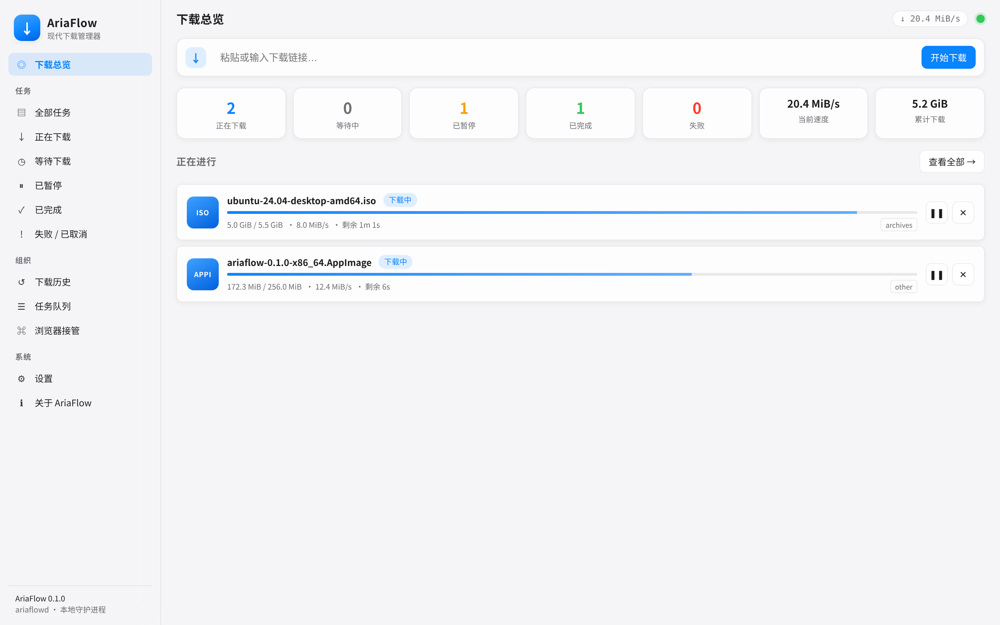
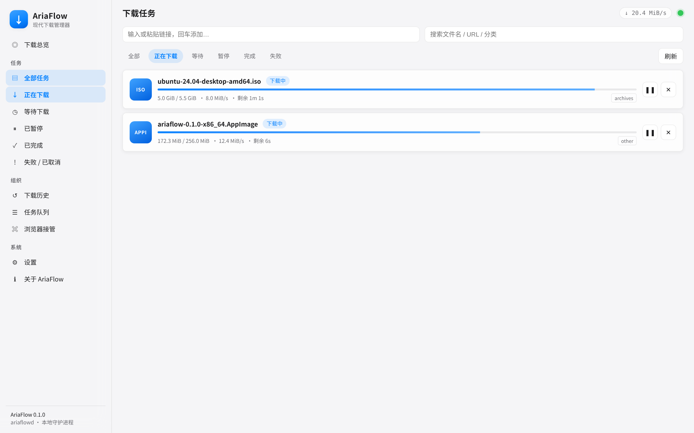
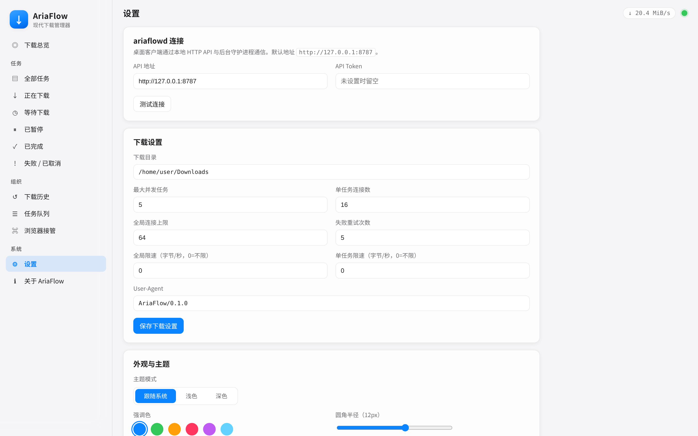

# AriaFlow

> 现代、快速、跨平台的下载管理器：Rust 内核 + 多协议守护进程 + 桌面 / 命令行 / TUI / 浏览器扩展客户端。

[](https://github.com/ariaflow/ariaflow/actions/workflows/ci.yml)
[](LICENSE)

AriaFlow 由三个可独立运行、相互协同的组件构成：

- **`ariaflowd`** —— 后台守护进程：所有下载、调度、断点续传、校验、SQLite 持久化都在这里完成；**同时提供 web API（默认 127.0.0.1:8787）、MCP（`/mcp`）、本地管道（Unix socket / Windows 命名管道，默认开启）与 Web 网页（桌面程序的 web 版，`/`，**编译期内嵌二进制，无需运行时 web 目录**；可用 `--web-dir` 覆盖为磁盘目录；可用 `--web-bind 0.0.0.0:9090` 绑定独立端口供局域网浏览器直接使用，**网页与 API 同源托管**）**；三个接口面（HTTP API / MCP / 网页）均可在 `PUT /api/v1/settings` 后**即时启停、不重启**（管道永远可用），见 [docs/API.md](docs/API.md) 与 [docs/ARCHITECTURE.md](docs/ARCHITECTURE.md)；
- **`ariaflow`** —— 命令行 / TUI 客户端：完整的任务管理能力，输出稳定、可脚本化、可直接喂给 AI 代理使用；**默认通过本地管道访问 daemon，可用 `--transport webapi` 走 web API**；TUI（`ariaflow --tui`）提供搜索（`/`）、排序循环（`s`）、重试（`t`）、优先级（`±`）、清空已完成（`c`）、快捷键帮助（`?`）；`ariaflow daemon start|restart --bin <path>` 可指定不在常用路径的 `ariaflowd`；
- **AriaFlow 桌面端** —— Vue 3 + TypeScript + Tauri 2 的 macOS 风格图形界面，作为守护进程的客户端运行；**可在设置中选择走 web API 或管道**。

所有客户端（GUI、CLI、TUI、浏览器扩展、MCP）都操作 `ariaflowd` 的同一套业务层，不重复实现任何业务逻辑；本地访问优先走管道，跨机器/浏览器访问走 web API。

## 特性

- ⚡ **高速分段下载**：类似 aria2 的 Range 多连接分段下载，支持动态分段、失败段重调度、段合并；
- 🔁 **完整断点续传**：任务中断/暂停后原样恢复，`If-Range` / ETag 协商，支持 MD5 / SHA-1 / SHA-256 / SHA-512 / BLAKE3 校验；
- 🧭 **调度器**：全局并发上限、单任务/全局连接数限制、全局/单任务限速、优先级、任务队列、自动重试、（架构预留）定时开始/时间窗口；
- 🌐 **常用协议内置**：HTTP/HTTPS（重定向、自定义请求头 / Cookie / UA / Basic / Bearer、HTTP & SOCKS5 代理、超时、自定义 CA）、FTP/FTPS（匿名/账号登录、REST 续传、被动模式）、SFTP（密码 / SSH agent / 密钥、seek 续传）、BitTorrent（magnet 与 http(s) `.torrent` 链接，分 piece 续传）、Metalink 3/4（镜像择优 + 校验）；
- 🧩 **浏览器接管**：Chrome / Firefox（MV3）扩展，把浏览器下载交给 ariaflowd，支持"用 AriaFlow 下载链接"右键菜单；
- 🤖 **AI 原生**：内置 MCP（Model Context Protocol）服务器，12 个工具 + JSON-Schema，危险操作需显式 `confirm`（stdio 与 `/mcp` HTTP 两种传输，共用同一套工具实现）；
- 🪝 **下载后钩子**：任务完成/永久失败时自动执行你配置的命令（IDM 式完成后处理 / aria2 `on-download-complete` / JDownloader 事件脚本），适合杀毒扫描、自动解压、通知；
- 📋 **粘贴/拖拽即添加**：桌面端任意位置 `Ctrl/Cmd+V` 粘贴链接、把链接拖进窗口或点剪贴板按钮即可添加；
- 🛡️ **同名不覆盖**：目标已存在或已有进行中的同名任务时，自动保存为 `name (1).ext`；
- 🖥️ **三平台**：Windows 10/11、Linux、macOS（Intel 与 Apple Silicon）；GUI 独立于核心，核心独立于 GUI。
- 🗂️ **文件夹选择器**：设置页“下载目录”与下载对话框“保存目录”均提供选择器——目录列表由 ariaflowd 经 `GET /api/v1/fs/list` 提供（Tauri 内走 IPC 管道、浏览器直连 API），支持面包屑导航、隐藏文件开关、键盘操作，也可直接手动输入路径；
- ✅ **多选与批量操作**：下载列表支持全选/部分选（表头 checkbox 有半选态），可批量暂停/继续/重试/删除（可勾选“连已下载文件一起删除”），已完成页支持一键“清空已完成”；下载历史支持多选删除与“清空所有”（`DELETE /api/v1/history[?ids=1,2,3]`，见 OpenAPI）；危险操作统一二次确认弹窗；
- 🌗 **主题一次生效**：浅色/深色/跟随系统在窗口首帧前应用（`index.html` 预读 localStorage，不再先闪暗色再亮色）；复选框统一为主题自适应的自绘样式；
- 🎛️ **控件全主题化**：下拉选择框、日期/时间选择器、强调色取色器全部改为自绘组件——没有浏览器/OS 原生外观、没有原生弹层，渲染与交互完全跟随应用主题（浅/深/强调色）；
- 🎨 **自由定制外观**：强调色除预设色板外可自由输入 `#rgb/#rrggbb` 或通过取色器选择（localStorage 持久化、启动即应用）；界面字号可整体缩放（90%/100%/115%/130%，含弹窗）；界面默认不可选中文字，输入框/路径/错误信息等可正常选中复制；
- 🖱️ **应用内右键菜单**：全局接管 `contextmenu`（桌面 + Web），任务行：查看详情（含当前链接、分段进度、速度/校验/时间线、可一键复制）/ 暂停·继续·重试 / 设置单任务限速 / 复制链接 / 删除（带“同时删除文件”勾选）；输入框：剪切/复制/粘贴/全选；选中文本/链接：复制；浏览器原生菜单一律抑制；
- 🐌 **单任务限速 UI**：添加下载的“高级选项”可直接设置 KB/s 限速（留空不限速），列表右键“设置限速”可随时调整/清除（预设 256K–10M + 自定义 KB/MB，`PUT /api/v1/downloads/{id}/limit-rate`，传输中的任务自动重启连接应用新限速）；
- 📱 **Web 界面响应式**：手机 / 平板自适应——窄屏下侧栏变为抽屉导航（汉堡按钮 + ESC/点击遮罩关闭），平板为图标栏，表格可横向滚动，表单单列堆叠；浏览器直接访问 `http://<机器IP>:8787/` 即可使用；
- 🔌 **ariaflowd 监听地址可配置**：`--api-bind` / `ARIAFLOW_API_BIND` / 设置页「ariaflowd 监听地址」/ `ariaflow config set api-bind 0.0.0.0:8787` / MCP `apiBind` 五种入口，改后重启生效（`--api-bind` 优先），写入被拒绝时返回 400 不会污染数据库；
- 📊 **概览页可自定义**：7 张统计卡片（正在下载/等待中/已暂停/已完成/失败/当前速度/总下载量）点击即跳转对应页面；“查看全部”左侧“显示内容”弹窗可勾选在概览页显示哪些卡片与列表条目（显示新建的任务 / 显示已暂停任务），选择保存到守护进程全局设置（`overviewHiddenCards` / `overviewShowNewTasks` / `overviewShowPaused`，`PUT /api/v1/settings`，重启后仍然有效）；“批量添加”为描边按钮；

## 快速开始

### 1. 从源码构建（Rust ≥ 1.80）

```bash
git clone https://github.com/ariaflow/ariaflow.git
cd ariaflow
cargo build --release -p ariaflow-daemon -p ariaflow-cli
# 或者：完全静态的 musl 产物（不依赖任何系统库，可拷到任意 x86_64 Linux 运行）
scripts/build-musl.sh
```

### 2. 启动守护进程并下载

```bash
# 启动 ariaflowd（默认监听 127.0.0.1:8787）
cargo run --release -p ariaflow-daemon &
# 已安装 `ariaflow` 时也可以：ariaflow daemon start            # 同目录 ariaflowd 或 PATH
#                                           ariaflow daemon start --bin /opt/ariaflow/bin/ariaflowd   # 自定义路径

# 添加下载任务（可多次重复，或按 Ctrl-C 退出 CLI，下载不受影响）
ariaflow add "https://example.com/release.iso" --connections 16
ariaflow list
ariaflow info <id>
ariaflow pause --all && ariaflow resume --all
```

### 3. 桌面端（可选）

```bash
cd apps/desktop
npm install
npm run build          # 类型检查 + 生产构建
npm run tauri:dev      # 启动 Tauri 窗口（需要系统 WebView，见 docs/BUILD.md）
```

> 关闭桌面窗口不会停止后台下载；AriaFlow 的下载由 `ariaflowd` 持有。

### 4. 浏览器扩展（可选）

见 [`browser-extension/README.md`](browser-extension/README.md)：加载 `browser-extension/chromium`（或 `firefox`）扩展，在扩展选项中配置 Web API 地址及 Token 后，浏览器下载可直接交给 ariaflowd，无需 native host。

## 仓库结构

```
AriaFlow/
├── crates/
│   ├── ariaflow-core       # 领域模型、事件、校验、文件名清洗、DownloadService 接口
│   ├── ariaflow-protocol   # 下载协议抽象（DownloadProvider trait）
│   ├── ariaflow-engine     # 传输引擎：HTTP/FTP/SFTP/BT/Metalink 提供器、分段/续传/限速/测速
│   ├── ariaflow-storage    # SQLite（WAL）+ 迁移 + Repository
│   ├── ariaflow-scheduler  # 全局调度：并发、限速、优先级、队列
│   ├── ariaflow-api        # Axum：HTTP API + 管道监听 + Web 网页托管 + SSE + Token 认证 + OpenAPI 3.0
│   ├── ariaflow-mcp        # MCP 服务器（stdio 与 daemon 内嵌 /mcp，面向 AI 代理）
│   ├── ariaflow-cli        # `ariaflow` 命令行
│   ├── ariaflow-daemon     # `ariaflowd` 守护进程（组装 core+storage+api+engine）
│   └── ariaflow-browser    # 旧版 Native Messaging 宿主（扩展不再依赖）
├── apps/desktop/           # Vue 3 + TS + Vite + Pinia + Vue Router + Tauri 2
├── browser-extension/      # chromium/ 与 firefox/ (MV3)
├── docs/                   # 架构 / API / CLI / 数据库 / 构建 / 开发文档
├── scripts/                # 构建与检查脚本
└── .github/workflows/      # CI（三大 OS 上 check / test / fmt / clippy）
```

## 文档

| 文档 | 内容 |
|---|---|
| [docs/ARCHITECTURE.md](docs/ARCHITECTURE.md) | 分层架构、模块边界、事件总线、安全设计 |
| [docs/API.md](docs/API.md) | HTTP API 参考（`/api/v1/...`，含 SSE 与认证） |
| [docs/CLI.md](docs/CLI.md) | `ariaflow` 命令行参考（JSON 输出、退出码） |
| [docs/DATABASE.md](docs/DATABASE.md) | SQLite 表结构与迁移说明 |
| [docs/BUILD.md](docs/BUILD.md) | 各平台构建、打包、依赖与许可证清单 |
| [docs/DEVELOPMENT.md](docs/DEVELOPMENT.md) | 开发环境、测试、代码规范 |
| [docs/FEATURE_MATRIX.md](docs/FEATURE_MATRIX.md) | 与 IDM / FDM / aria2 / JDownloader / Motrix 的功能对照、本轮移植说明与路线图 |

## 界面预览

桌面端（浅色模式）连接本地 `ariaflowd` 的实时效果：



任务列表与设置页（外观主题、ariaflowd 连接、下载参数）：

| 下载任务 | 设置 |
|---|---|
|  |  |

## 当前状态与路线图

**已验证**（2026-11）：构建、单元测试、守护进程启动、HTTP API（含 SSE、探测、OpenAPI 输出）、管道（Unix socket）监听、`/` 托管桌面 web 版（内嵌、含 SPA 回退与 `/api/*` JSON 404）、`/mcp` MCP 挂载（initialize / tools/list / tools/call，与 stdio 共用工具实现）、CLI 全部命令（`--transport auto|ipc|webapi`，含回退语义；`daemon start/restart --bin <path>` 指定 ariaflowd 路径）、下载后钩子、同名去重、MCP 工具调用（含危险操作确认保护）、桌面 web 构建、**三个接口面（web API / MCP / 网页）运行时即时启停**（503 `feature_disabled` 降级 + 跨重启持久化 + 管道始终可用）、**独立 web 端口**（`--web-bind`/`webUiBind`，重启生效，局域网可用）、**Linux WebKit 空白窗口兜底**与内容区可见滚动条、**本机回环免限流**（局域网 600 req/min）、**控件全自绘主题化**（下拉选择框 / 日期时间选择器 / 强调色取色器，浅/深主题一致）、**概览页自定义显示内容**（卡片点击跳转 + “显示内容”弹窗，daemon 全局设置持久化）、**TUI 扩展**（搜索 / 排序循环 / 重试 / 优先级 / 清空已完成 / 快捷键帮助）。

预览中 / 计划中的里程碑（详见 [docs/FEATURE_MATRIX.md](docs/FEATURE_MATRIX.md)）：

- [ ] 引擎：HTTP 动态分段再平衡（IDM 式 dynamic segmentation；当前为静态分段）
- [ ] 完成时系统通知（Notification API；可经 `on-download-complete-command` 自行实现）
- [ ] 桌面端内嵌 ariaflowd sidecar（目前需单独运行守护进程）
- [ ] 浏览器扩展"下载本页全部链接"右键能力
- [ ] 浏览器接管页深度集成（浏览器扩展管理页面面目前为功能入口占位）

## 许可证

[MIT](LICENSE)。第三方依赖均为宽松许可证（MIT / Apache-2.0 / ISC / BSD / Unicode-3.0），详见 [docs/BUILD.md](docs/BUILD.md) 的"依赖与许可证"一节。
